# MarkDown Mermaid高级绘图--简单积累

## 饼图

```
​```mermaid
pie
   title Example Pie Chart
   "First slice": 30
   "Second slice": 20
   "Third slice": 50
​```
```

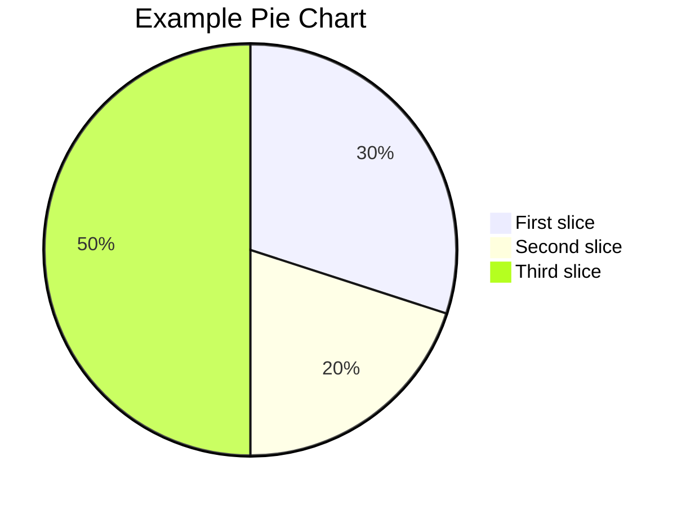

## 简单流程图

```
​```mermaid
graph TD;
    A-->B;
    A-->C;
    B-->D;
    C-->D;
​```
```

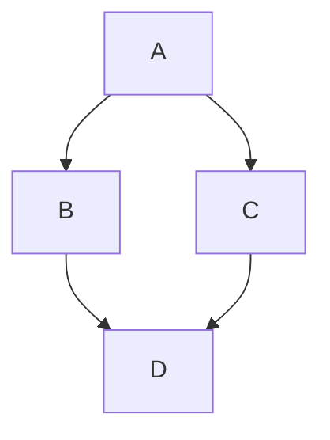
```
​```mermaid
flowchart LR
    A[Hard edge] -->|Link text| B(Round edge)
    B --> C{Decision}
    C -->|One| D[Result one]
    C -->|Two| E[Result two]
​```
```

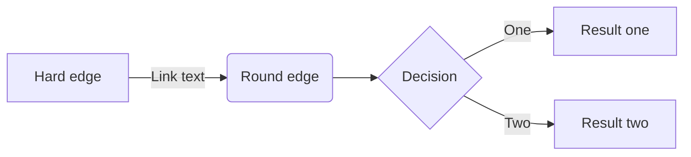

```
​```mermaid
flowchart TD
  A[开始] -->|条件1| B[流程1]
  B -->|条件2| C[流程2]
  C -->|条件3| D[流程3]
  D -->|条件4| E[结束]
​```
```

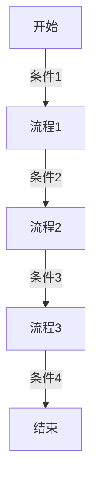


## 实体关系图

```
​```mermaid
erDiagram
    CUSTOMER ||--o{ ORDER : places
    ORDER ||--|{ LINE-ITEM : contains
    CUSTOMER }|..|{ DELIVERY-ADDRESS : uses
​```
```


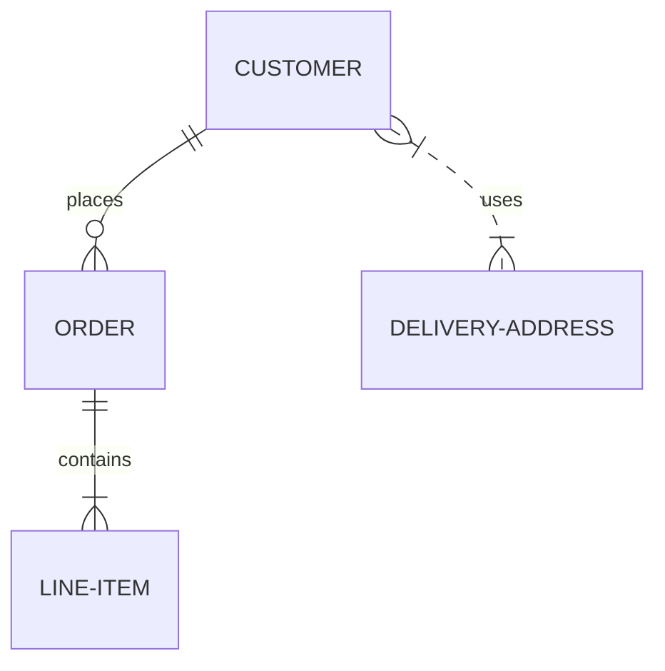

## 甘特图

```
​```mermaid
gantt
  title 项目计划
  dateFormat  YYYY-MM-DD
  section 研发
  设计 :a1, 2018-01-01, 15d
  开发 :a2, 2018-01-03, 30d
  测试 :a3, after a2, 20d
  section 上线
  发布 :b1, after a3, 2d
  测试 :b2, after b1, 5d

​```
```

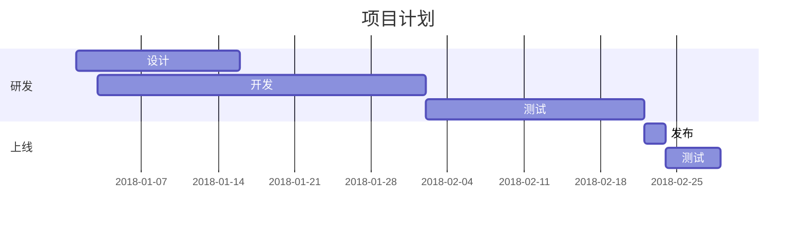

## 树状图

```
graph TD
  A[开始] --> B[分类1]
  B --> C[子分类1]
  B --> D[子分类2]
  C --> E[项目1]
  C --> F[项目2]
  D --> G[项目3]
  D --> H[项目4]

```

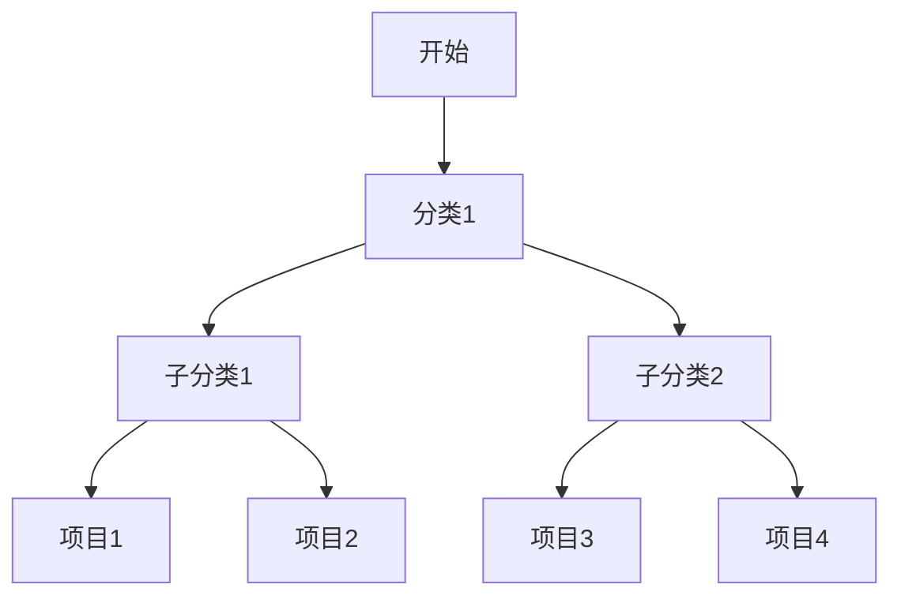

## 题目流程图

```
​```mermaid
sequenceDiagram
  A->B: 请求A
  B->>C: 请求B
  B->>D: 请求C
  C-->>B: 返回C
  D-->>B: 返回D
  B-->>A: 返回B

​```
```

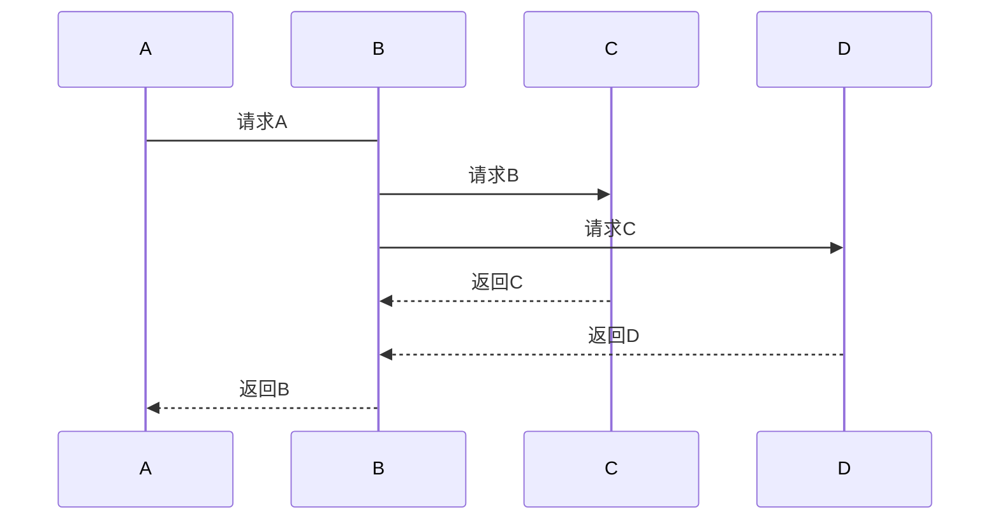

## 状态转换图

```

```

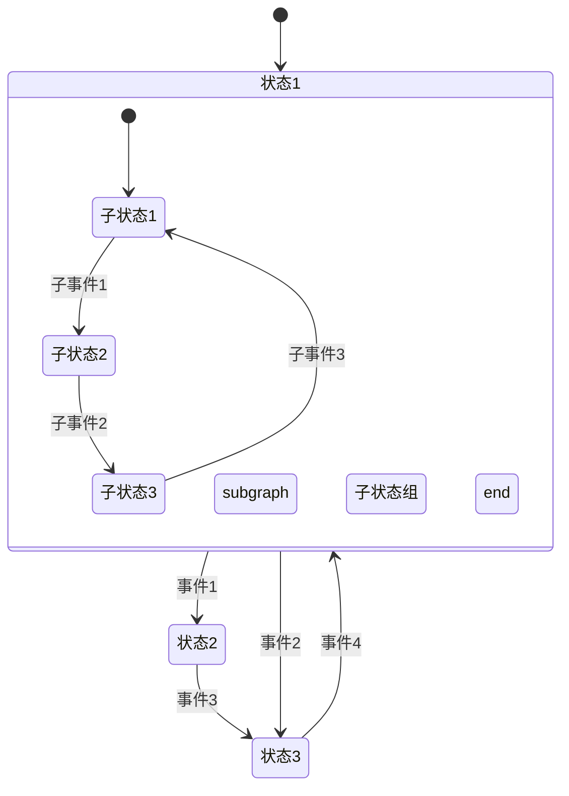


## 流程图实践
```
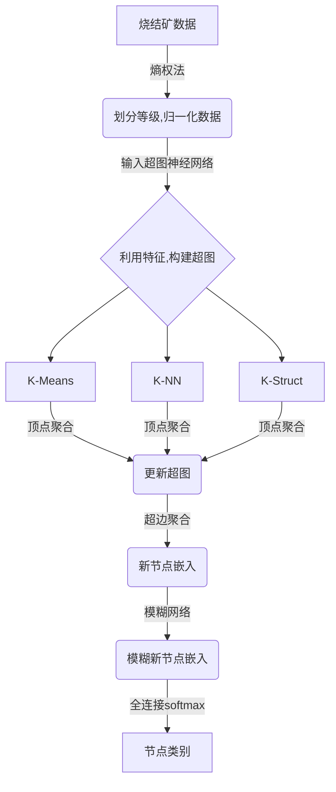


## 技术路线图实践


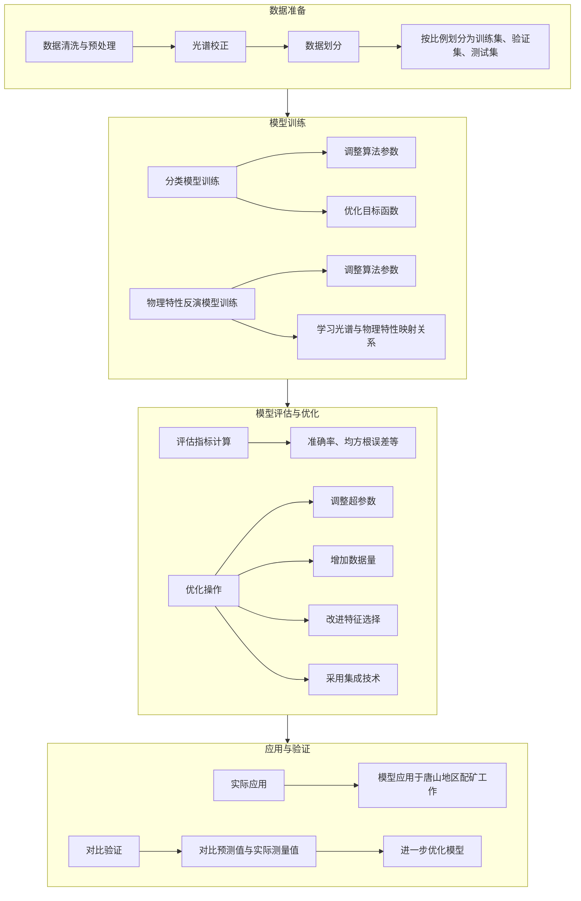
